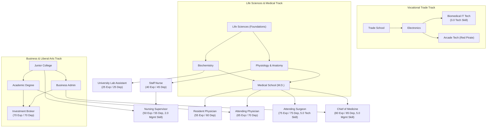

# Advanced 2000 Iteration Plan & Game Design Roadmap

This document outlines the design decisions, trade-offs, and implementation plan for the second phase of **The Fast Lane — Advanced 2000** (`advanced_2000`).

---

## 1. Park vs. Home Actions: Balance & Situational Trade-offs

### The Core Problem
In the initial iteration, `stroll_park` cost 1 hour and granted `+1 Physical, +1 Mental`. Executing this 6 times yielded `+6 Physical, +6 Mental` for 6 hours with zero food, zero mess, zero cash, and zero risk. This inadvertently made park strolling superior to Home Relax in almost every early/mid-game scenario.

### Design Principles
1. **Home Relax should be the foundational, high-ceiling recovery anchor**:
   - Private, secure, controlled environment.
   - Scalable through appliances (microwave, TV, hot tub).
   - Contributes to home security (`homeTimeThisTurn` reducing burglary risk).
   - Requires food in pantry and creates domestic mess.
2. **Park actions should be *situationally* superior**:
   - Location proximity (avoiding a 4-hour commute home across the city ring).
   - Escaping a disaster-zone apartment (when mess ≥ 10 debuffs home recovery).
   - Emergency sanctuary when broke/starving (avoiding the brutal unfed home penalty).
3. **Synergy & Mixed Optimal Play (Fresh Air vs. Home Comfort)**:
   - Introduce a mechanical reason to use both:
     - **Cabin Fever / Stir Crazy**: Repeatedly relaxing at home without leaving grants diminishing mental returns.
     - **Breath of Fresh Air**: Taking a park stroll grants a temporary morale boost (`fresh_air`) that enhances the next home relaxation or work shift.
4. **Lack of Privacy & Public Exposure (Random Events)**:
   - At home, you control your environment. In a public park, you are exposed.
   - Parks should feature dynamic random encounters:
     - **Positive**: Sunny day / gentle breeze (`+1 Physical`), busker music (`+2 Mental`), finding loose pocket change (`+$5`), friendly dog (`+1 Social`).
     - **Negative**: Sudden downpour (`-1 Physical`, damp clothes), pushy solicitor / panhandler (`-1 Mental`), pickpocket / mugging risk.
     - **Situational Risk Scaling**: Carrying large amounts of unbanked cash (`>$200`) increases mugging risk, creating a natural game-loop incentive to deposit money before idling in parks.
5. **Action Restructuring**:
   - Consolidate micro-actions from 1-hour spam into substantive 2-hour or 3-hour commitments:
     - **Park Stroll** (2h or 3h): Refreshing walk, clears head, gives `fresh_air` buff.
     - **Bench Rest / Nap** (3h): Free recovery, but higher exposure to weather and street events.
     - **Trail Jog / Workout** (3h): Dedicated athletic training, builds `+1 Max Physical`, expends Mental stamina.

---

## 2. Jobs, Hospital Ladder, Skills, and Education Overhaul

*This phase establishes the 9-tier hospital career ladder, aligns classic jobs to baseline parity, establishes the Life Sciences degree branch, and implements clinical shift adaptations.*

### Architecture & Education Tracks

### Sub-Phase 2A: Baseline Alignment for Classic Locations & Broker
- **100% Classic Baseline Parity**:
  - Revert all legacy locations (Z-Mart, QT Clothing, Socket City, Bank, University, Black's Market, Rent Office) strictly back to their classic `advanced` values:
    - Restores exact wages, experience/dependability thresholds, uniforms, and degree requirements.
    - Eliminates unintended stat drift (e.g. Z-Mart Clerk returning to 10 Exp / 10 Dep, Manager to 30 Exp / 30 Dep).
  - Any future job re-theming or wage adjustments will be handled in dedicated gameplay-first iterations with distinct modern job titles (e.g. dot-com era roles), rather than silently altering classic staples.
- **Restore the Iconic Broker**:
  - Requirements: `70 Experience`, `70 Dependability`, `["business_admin", "academic"]`, business uniform, `` `$22` `` wage.
  - Solidifies the `academic` degree's high-earning financial application outside of academia.

### Sub-Phase 2B: The `clinical` Tag & Hospital Shift Adaptations
- **No 3rd Abstract Skill**:
  - Medical roles are gated naturally by strict Dependability bars, existing skills (`skillTech` and `skillMgmt`), and the Life Sciences education branch.
- **The Mechanical Role of the `clinical` Tag**:
  1. **"Grand Rounds" (Replaces `face_time`)**:
     - At the Hospital, staff do not schmooze the water cooler. Instead, they attend Clinical Case Review / Grand Rounds.
     - Consumes Mental stamina and time to review complex patient cases with senior staff, clearing location demerits and rebuilding Dependability.
  2. **"Charting & Paperwork" (Replaces `look_busy`)**:
     - Instead of hiding behind stockroom shelves, medical staff retreat to the nursing station to write up patient charts and update medical records.
     - Mechanics: Halves physical drain, awards base `+1 Dependability` (completing medical charts on time builds dependability!), but grants `0 Experience`.
  3. **High-Stakes Mistakes (`-2 Mental Shock`)**:
     - A mistake on a `clinical` shift reflects patient risk and acute professional scrutiny.
     - Triggers an immediate extra penalty of `-2 Mental condition` (clinical stress/guilt) alongside standard mistake demerits.
  4. **The "Noble Aura" (Rent Office Standing Bonus)**:
     - Healthcare workers gain an explicit bonus during lease renegotiations at the Rent Office (landlords appreciate reputable, stable healthcare tenants).
  5. **Zero Downtime**:
     - Unlike retail or pawn shops, Hospital jobs are fast-paced and high-pressure; none carry the `high_downtime` tag.

### Sub-Phase 2C: Education Overhaul — The 3-Track System
1. **Vocational Track**: `trade_school` ──> `electronics`.
2. **Business & Academic Track**: `junior_college` ──> `business_admin` & `academic`.
3. **Life Sciences & Medical Track**:
   - `life_sciences` (Foundations of Health & Biology, tuition `` `$50` ``, 10 lessons).
   - `physiology` (requires `life_sciences`, tuition `` `$50` ``, 10 lessons). Unlocks Staff Nurse.
   - `biochemistry` (requires `life_sciences`, tuition `` `$50` ``, 10 lessons). Unlocks University Lab Assistant.
   - `medical_school` (M.D.) (requires `["physiology", "biochemistry"]`, tuition `` `$60` ``, 12 lessons). Unlocks Doctor tiers.

### Sub-Phase 2D: The 9 Hospital Jobs & University Lab Assistant
- **Hospital Ladder (9 In-Hospital Tiers)**:
  1. **Hospital Orderly**: Entry level / Heavy Physical (15 Exp / 20 Dep, no degree, casual uniform, wage `` `$7` ``). Tags: `["always_hiring", "heavy_physical"]`.
  2. **Ward Clerk / Receptionist**: Frontline Service / Administrative (20 Exp / 25 Dep, `junior_college` or `life_sciences`, casual uniform, wage `` `$9` ``). Tags: `["frontline_service"]`.
  3. **Biomedical IT Tech**: Technical Support (30 Exp / 30 Dep, `electronics`, 3.0 `skillTech`, casual uniform, wage `` `$14` ``). Tags: `["technical"]`.
  4. **Staff Nurse (RN)**: Bedside Care (40 Exp / 45 Dep, `physiology`, casual uniform, wage `` `$18` ``). Tags: `["frontline_service", "clinical"]`.
  5. **Nursing Supervisor**: Clinical Middle Management (50 Exp / 55 Dep, `physiology` + `junior_college`, 2.0 `skillMgmt`, dress uniform, wage `` `$22` ``). Tags: `["middle_management", "clinical"]`.
  6. **Resident Physician**: Post-MD Clinical Overtime (55 Exp / 60 Dep, `medical_school`, dress uniform, wage `` `$20` ``). Tags: `["clinical"]`.
  7. **Attending Physician**: Board Certified Clinical (65 Exp / 70 Dep, `medical_school` + `academic`, business uniform, wage `` `$27` ``). Tags: `["clinical"]`.
  8. **Attending Surgeon**: Specialized Surgical Clinical (75 Exp / 75 Dep, `medical_school`, 5.0 `skillTech`, casual/scrubs uniform, wage `` `$32` ``). Tags: `["clinical", "technical"]`.
  9. **Chief of Medicine / Medical Director**: Hospital Executive (80 Exp / 85 Dep, `medical_school` + `business_admin`, 5.0 `skillMgmt`, business uniform, wage `` `$36` ``). Tags: `["executive_management", "clinical"]`.
- **University Role**:
  - Add **`uni_lab_assistant` (Lab Research Assistant)**: 25 Exp / 25 Dep, requires `biochemistry`, casual uniform, wage `` `$10` ``. Tags: `["technical"]`. Gives `biochemistry` an immediate academic application outside the hospital.

---

## 3. Hospital Actions: Game-First Design

Rather than adding hospital actions solely for narrative flavor or symmetry, every interaction must serve a distinct, non-redundant mechanical role in the game loop:

1. **Walk-in Urgent Clinic (Proactive Stabilization)**:
   - *Game problem solved*: In the base game, medical treatment only occurs randomly after a catastrophic collapse or starvation.
   - *Mechanic*: Spend 2 hours and `` `$50` `` (free for hospital employees) to proactively treat ailments, recover `+6 Physical`, and reset physical drop penalties before an emergency strikes.
2. **Psychiatric Counseling / Therapy (Burnout Treatment)**:
   - *Game problem solved*: When mental condition drops continuously, resilience and happiness spiral downward. Ordinary sleep cannot rapidly reverse burnout.
   - *Mechanic*: Spend 2 hours and `` `$60` `` for clinical therapy (`+6 Mental`, clears mental drop streak).
3. **Emergency Blood Donation (High-Stakes Rescue Cash)**:
   - *Game problem solved*: When completely broke (`` `$0` ``), unable to afford food or travel, players often enter an unwinnable death spiral.
   - *Mechanic*: Donate blood: gain `` `$40` `` immediate cash and `+1 Social`, at the cost of `-3 Physical condition` and 2 hours. High risk, desperate relief.
4. **Hospital Cafeteria (Emergency Low-Cost Meal)**:
   - Cheap institutional food (`` `$10` ``) available without traveling to a grocery store, providing hunger relief with zero or slight negative happiness.
5. **Hospital Character / Face**:
   - Replace default factory welder emoji with `👩‍⚕️` (Triage Nurse Carla) with authentic reception dialogue reacting to player health status.

---

## 4. Coffee Subsystem & The "All-Nighter" / High-Caffeine Mechanics

### Framing & Turn Structure Analysis
- *The "All-Nighter" Dilemma*: Because turns represent 1 week (Monday–Friday) followed by the Weekend, a single "all-nighter" can feel conceptually disconnected if framed as a 48-hour weekend.
- **Refined Gameplay Concepts**:
  - **Concept A: The "Caffeine-Fueled Weekend Sprint" (Weekend Card)**:
    - If `coffeeCupsThisTurn >= 3`, a special weekend card enters the draw pool:
      - *Thesis / Cramming Sprint*: Complete 2 free university lesson credits over the weekend.
      - *Moonlighting Freelance*: Earn `` `$120` `` cash +2 Exp, +2 Dep.
      - *Creative / Gaming Binge*: `+6 Mental`, `+4 Happiness`, but start Monday with `-2 Physical`.
  - **Concept B: Mid-Turn "Overdrive / Burning the Midnight Oil" Action**:
    - High caffeine enables a mid-week push: spend beyond normal weekly hours (e.g. take a shift or study session even with 0 hours remaining, incurring next turn's `caffeineDebt` or physical exhaustion).
  - **Concept C: Coffee as an Active Replacement for the Lottery**:
    - Classic lottery tickets at Z-Mart were passive, low-agency coin flips.
    - Coffee can incorporate a "Cup Scratch-Off / Loyalty Promotion" (e.g. every 5th coffee has a chance to win store credit or cash prizes), blending high-agency stamina management with casual lottery excitement.

---

## Implementation Sequence
1. **Step 1**: Park Actions & Home Relax Balance (Math, diminishing returns, fresh air synergy, and street events).
2. **Step 2A**: Restore classic job baselines and Broker degree requirements.
3. **Step 2B**: Skill system evaluation (rust/decay vs. degree floors).
4. **Step 2C**: Education DAG overhaul (Trade School nursing track, Medical School prerequisites).
5. **Step 2D**: Prune Hospital jobs to 9 tiers.
6. **Step 3**: Hospital Building Actions & Triage Receptionist.
7. **Step 4**: High-caffeine weekend sprints and coffee/lottery integration.
