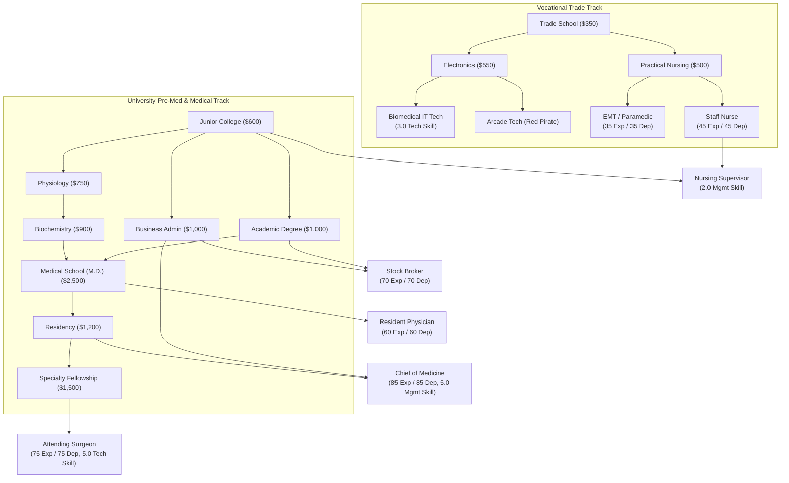

# Advanced 2000 Iteration Plan & Game Design Roadmap

This document outlines the design decisions, trade-offs, and implementation plan for the second phase of **The Fast Lane — Advanced 2000** (`advanced_2000`).

---

## 1. Park vs. Home Actions: Balance & Situational Trade-offs

### The Core Problem
In the initial iteration, `stroll_park` cost 1 hour and granted `+1 Physical, +1 Mental`. Executing this 6 times yielded `+6 Physical, +6 Mental` for 6 hours with zero food, zero mess, zero cash, and zero risk. This inadvertently made park strolling superior to Home Relax in almost every early/mid-game scenario.

### Design Principles
1. **Home Relax should be the foundational, high-ceiling recovery anchor**:
   - Private, secure, controlled environment.
   - Scalable through appliances (microwave, TV, hot tub).
   - Contributes to home security (`homeTimeThisTurn` reducing burglary risk).
   - Requires food in pantry and creates domestic mess.
2. **Park actions should be *situationally* superior**:
   - Location proximity (avoiding a 4-hour commute home across the city ring).
   - Escaping a disaster-zone apartment (when mess ≥ 10 debuffs home recovery).
   - Emergency sanctuary when broke/starving (avoiding the brutal unfed home penalty).
3. **Synergy & Mixed Optimal Play (Fresh Air vs. Home Comfort)**:
   - Introduce a mechanical reason to use both:
     - **Cabin Fever / Stir Crazy**: Repeatedly relaxing at home without leaving grants diminishing mental returns.
     - **Breath of Fresh Air**: Taking a park stroll grants a temporary morale boost (`fresh_air`) that enhances the next home relaxation or work shift.
4. **Lack of Privacy & Public Exposure (Random Events)**:
   - At home, you control your environment. In a public park, you are exposed.
   - Parks should feature dynamic random encounters:
     - **Positive**: Sunny day / gentle breeze (`+1 Physical`), busker music (`+2 Mental`), finding loose pocket change (`+$5`), friendly dog (`+1 Social`).
     - **Negative**: Sudden downpour (`-1 Physical`, damp clothes), pushy solicitor / panhandler (`-1 Mental`), pickpocket / mugging risk.
     - **Situational Risk Scaling**: Carrying large amounts of unbanked cash (`>$200`) increases mugging risk, creating a natural game-loop incentive to deposit money before idling in parks.
5. **Action Restructuring**:
   - Consolidate micro-actions from 1-hour spam into substantive 2-hour or 3-hour commitments:
     - **Park Stroll** (2h or 3h): Refreshing walk, clears head, gives `fresh_air` buff.
     - **Bench Rest / Nap** (3h): Free recovery, but higher exposure to weather and street events.
     - **Trail Jog / Workout** (3h): Dedicated athletic training, builds `+1 Max Physical`, expends Mental stamina.

---

## 2. Jobs, Hospital Ladder, Skills, and Education Overhaul

*This item is large and intertwined; it is broken into four distinct sub-phases.*

### AI Suggestions & Proposed Architecture

### Sub-Phase 2A: Baseline Alignment for Classic Locations & Broker
- Restore the exact classic `advanced` job definitions for established locations:
  - Z-Mart, QT Clothing, Socket City, Bank, University, Black's Market, and Apartment Complex.
  - Fix unintended stat drift (e.g. Z-Mart clerk returning to 10 Exp / 10 Dep, manager to 30 Exp / 30 Dep).
- Restore the **Broker** to its iconic pinnacle requirements:
  - `70 Experience`, `70 Dependability`, `["business_admin", "academic"]`.
  - Gives the `academic` degree a high-earning financial application outside of academia.

### Sub-Phase 2B: The Skill System Audit (`skillTech`, `skillMgmt`)
- **Do we keep skills?**:
  - Yes: Skills prevent high-tier jobs from being raw stat grinds and allow technical and managerial careers to feel mechanically distinct.
  - In Advanced 2000, `skillTech` powers Socket City, the Arcade Technician, and Hospital surgical/biomedical roles. `skillMgmt` powers corporate and hospital administrative leadership.
- **Skill Decay ("Rust")**:
  - Should skills decay if unused?
  - *Recommendation*: If implemented, it should be gentle and forgiving:
    - Only begins after 2 consecutive turns without practicing the skill (working a relevant shift, leading an initiative, or studying).
    - Decays by `-0.1` per turn.
    - **Hard floor**: Completed degrees provide permanent skill baselines (e.g. Business Administration guarantees `skillMgmt` never drops below `2.5`). You can get rusty, but you never forget your foundational education.
- **Should we add a third skill (Clinical / Medical)?**:
  - *Caution against skill bloat*: Adding `skillClinical` on top of technical and management skills adds HUD clutter and cognitive load. The medical ladder can be fully and cleanly gated using the deep medical degree chain plus existing `skillTech` (surgical dexterity) and `skillMgmt` (nursing supervision/hospital director).

### Sub-Phase 2C: Education DAG Restructure (Trade School vs. Junior College)
- **The Issue**: Currently, `junior_college` unlocks Business, Academic, and all Medical degrees, while `trade_school` only unlocks `electronics`. Furthermore, players could rush an M.D. in 3 degrees without ever studying Physiology.
- **The Restructured DAG**:
  - **Trade School Vocational Track**:
    - `trade_school` ──> `electronics` (Biomedical Tech, Socket City Repair)
    - `trade_school` ──> `practical_nursing` (EMT, Staff Nurse)
    - *Result*: Trade School becomes the rapid, debt-friendly vocational healthcare pathway.
  - **University / Pre-Med Academic Track**:
    - `junior_college` ──> `physiology` (Foundations of Health)
    - `physiology` ──> `biochemistry` (Cellular & Organic Chemistry)
    - `biochemistry` + `academic` ──> `medical_school` (M.D.) (Requires full bachelor foundation)
    - `medical_school` ──> `residency` (Clinical training)
    - `residency` ──> `specialty_fellowship` (Surgical specialization)
  - Tuition and lesson counts scaled so M.D. is an authentic prestige journey.

### Sub-Phase 2D: Hospital Job Ladder Pruning
- Prune Hospital jobs from 11 down to 9 (matching the classic Factory's 9 jobs):
  1. **Hospital Orderly** (Entry / Heavy Physical, 10 Exp / 10 Dep, no degree)
  2. **Ward Clerk / Receptionist** (Frontline Service, 20 Exp / 20 Dep, `junior_college`)
  3. **Biomedical IT Tech** (Technical, 30 Exp / 30 Dep, `trade_school` + `electronics`, 3.0 `skillTech`)
  4. **EMT / Paramedic** (Frontline Urgent, 35 Exp / 35 Dep, `trade_school` + `practical_nursing`)
  5. **Staff Nurse (RN)** (Clinical Physical, 45 Exp / 45 Dep, `practical_nursing`)
  6. **Nursing Supervisor** (Middle Management, 55 Exp / 55 Dep, `practical_nursing` + `junior_college`, 2.0 `skillMgmt`)
  7. **Resident Physician** (Clinical Overtime, 60 Exp / 60 Dep, `medical_school`)
  8. **Attending Surgeon** (High Technical Clinical, 75 Exp / 75 Dep, `specialty_fellowship`, 5.0 `skillTech`)
  9. **Chief of Medicine / Medical Director** (Executive Pinnacle, 85 Exp / 85 Dep, `residency` + `business_admin`, 5.0 `skillMgmt`)

---

## 3. Hospital Actions: Game-First Design

Rather than adding hospital actions solely for narrative flavor or symmetry, every interaction must serve a distinct, non-redundant mechanical role in the game loop:

1. **Walk-in Urgent Clinic (Proactive Stabilization)**:
   - *Game problem solved*: In the base game, medical treatment only occurs randomly after a catastrophic collapse or starvation.
   - *Mechanic*: Spend 2 hours and `` `$50` `` (free for hospital employees) to proactively treat ailments, recover `+6 Physical`, and reset physical drop penalties before an emergency strikes.
2. **Psychiatric Counseling / Therapy (Burnout Treatment)**:
   - *Game problem solved*: When mental condition drops continuously, resilience and happiness spiral downward. Ordinary sleep cannot rapidly reverse burnout.
   - *Mechanic*: Spend 2 hours and `` `$60` `` for clinical therapy (`+6 Mental`, clears mental drop streak).
3. **Emergency Blood Donation (High-Stakes Rescue Cash)**:
   - *Game problem solved*: When completely broke (`` `$0` ``), unable to afford food or travel, players often enter an unwinnable death spiral.
   - *Mechanic*: Donate blood: gain `` `$40` `` immediate cash and `+1 Social`, at the cost of `-3 Physical condition` and 2 hours. High risk, desperate relief.
4. **Hospital Cafeteria (Emergency Low-Cost Meal)**:
   - Cheap institutional food (`` `$10` ``) available without traveling to a grocery store, providing hunger relief with zero or slight negative happiness.
5. **Hospital Character / Face**:
   - Replace default factory welder emoji with `👩‍⚕️` (Triage Nurse Carla) with authentic reception dialogue reacting to player health status.

---

## 4. Coffee Subsystem & The "All-Nighter" / High-Caffeine Mechanics

### Framing & Turn Structure Analysis
- *The "All-Nighter" Dilemma*: Because turns represent 1 week (Monday–Friday) followed by the Weekend, a single "all-nighter" can feel conceptually disconnected if framed as a 48-hour weekend.
- **Refined Gameplay Concepts**:
  - **Concept A: The "Caffeine-Fueled Weekend Sprint" (Weekend Card)**:
    - If `coffeeCupsThisTurn >= 3`, a special weekend card enters the draw pool:
      - *Thesis / Cramming Sprint*: Complete 2 free university lesson credits over the weekend.
      - *Moonlighting Freelance*: Earn `` `$120` `` cash +2 Exp, +2 Dep.
      - *Creative / Gaming Binge*: `+6 Mental`, `+4 Happiness`, but start Monday with `-2 Physical`.
  - **Concept B: Mid-Turn "Overdrive / Burning the Midnight Oil" Action**:
    - High caffeine enables a mid-week push: spend beyond normal weekly hours (e.g. take a shift or study session even with 0 hours remaining, incurring next turn's `caffeineDebt` or physical exhaustion).
  - **Concept C: Coffee as an Active Replacement for the Lottery**:
    - Classic lottery tickets at Z-Mart were passive, low-agency coin flips.
    - Coffee can incorporate a "Cup Scratch-Off / Loyalty Promotion" (e.g. every 5th coffee has a chance to win store credit or cash prizes), blending high-agency stamina management with casual lottery excitement.

---

## Implementation Sequence
1. **Step 1**: Park Actions & Home Relax Balance (Math, diminishing returns, fresh air synergy, and street events).
2. **Step 2A**: Restore classic job baselines and Broker degree requirements.
3. **Step 2B**: Skill system evaluation (rust/decay vs. degree floors).
4. **Step 2C**: Education DAG overhaul (Trade School nursing track, Medical School prerequisites).
5. **Step 2D**: Prune Hospital jobs to 9 tiers.
6. **Step 3**: Hospital Building Actions & Triage Receptionist.
7. **Step 4**: High-caffeine weekend sprints and coffee/lottery integration.
