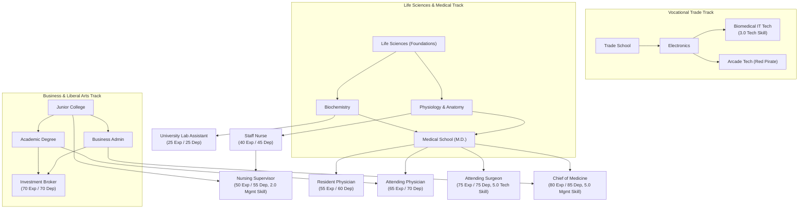

# Advanced 2000 Iteration Plan & Game Design Roadmap

This document outlines the design decisions, trade-offs, and implementation plan for the second phase of **The Fast Lane — Advanced 2000** (`advanced_2000`).

---

## 1. Park vs. Home Actions: Balance & Situational Trade-offs

### The Core Problem
In the initial iteration, `stroll_park` cost 1 hour and granted `+1 Physical, +1 Mental`. Executing this 6 times yielded `+6 Physical, +6 Mental` for 6 hours with zero food, zero mess, zero cash, and zero risk. This inadvertently made park strolling superior to Home Relax in almost every early/mid-game scenario.

### Design Principles
1. **Home Relax should be the foundational, high-ceiling recovery anchor**:
   - Private, secure, controlled environment.
   - Scalable through appliances (microwave, TV, hot tub).
   - Contributes to home security (`homeTimeThisTurn` reducing burglary risk).
   - Requires food in pantry and creates domestic mess.
2. **Park actions should be *situationally* superior**:
   - Location proximity (avoiding a 4-hour commute home across the city ring).
   - Escaping a disaster-zone apartment (when mess ≥ 10 debuffs home recovery).
   - Emergency sanctuary when broke/starving (avoiding the brutal unfed home penalty).
3. **Synergy & Mixed Optimal Play (Fresh Air vs. Home Comfort)**:
   - Introduce a mechanical reason to use both:
     - **Cabin Fever / Stir Crazy**: Repeatedly relaxing at home without leaving grants diminishing mental returns.
     - **Breath of Fresh Air**: Taking a park stroll grants a temporary morale boost (`fresh_air`) that enhances the next home relaxation or work shift.
4. **Lack of Privacy & Public Exposure (Random Events)**:
   - At home, you control your environment. In a public park, you are exposed.
   - Parks should feature dynamic random encounters:
     - **Positive**: Sunny day / gentle breeze (`+1 Physical`), busker music (`+2 Mental`), finding loose pocket change (`` `+$5` ``), friendly dog (`+1 Social`).
     - **Negative**: Sudden downpour (`-1 Physical`, damp clothes), pushy solicitor / panhandler (`-1 Mental`), pickpocket / mugging risk.
     - **Situational Risk Scaling**: Carrying large amounts of unbanked cash (`` `> $200` ``) increases mugging risk, creating a natural game-loop incentive to deposit money before idling in parks.
5. **Action Restructuring**:
   - Consolidate micro-actions from 1-hour spam into substantive 2-hour or 3-hour commitments:
     - **Park Stroll** (2h or 3h): Refreshing walk, clears head, gives `fresh_air` buff.
     - **Bench Rest / Nap** (3h): Free recovery, but higher exposure to weather and street events.
     - **Trail Jog / Workout** (3h): Dedicated athletic training, builds `+1 Max Physical`, expends Mental stamina.

---

## 2. Jobs, Hospital Ladder, Skills, and Education Overhaul

*This phase establishes the 9-tier hospital career ladder, aligns classic jobs to baseline parity, establishes the Life Sciences degree branch, and implements clinical shift adaptations.*

### Architecture & Education Tracks

### Sub-Phase 2A: Baseline Alignment for Classic Locations & Broker
- **100% Classic Baseline Parity**:
  - Revert all legacy locations (Z-Mart, QT Clothing, Socket City, Bank, University, Black's Market, Rent Office) strictly back to their classic `advanced` values:
    - Restores exact wages, experience/dependability thresholds, uniforms, and degree requirements.
    - Eliminates unintended stat drift (e.g. Z-Mart Clerk returning to 10 Exp / 10 Dep, Manager to 30 Exp / 30 Dep).
  - Any future job re-theming or wage adjustments will be handled in dedicated gameplay-first iterations with distinct modern job titles (e.g. dot-com era roles), rather than silently altering classic staples.
- **Restore the Iconic Broker**:
  - Requirements: `70 Experience`, `70 Dependability`, `["business_admin", "academic"]`, business uniform, `` `$22` `` wage.
  - Solidifies the `academic` degree's high-earning financial application outside of academia.

### Sub-Phase 2B: The `clinical` Tag & Hospital Shift Adaptations
- **No 3rd Abstract Skill**:
  - Medical roles are gated naturally by strict Dependability bars, existing skills (`skillTech` and `skillMgmt`), and the Life Sciences education branch.
- **The Mechanical Role of the `clinical` Tag**:
  1. **"Grand Rounds" (Replaces `face_time`)**:
     - At the Hospital, staff do not schmooze the water cooler. Instead, they attend Clinical Case Review / Grand Rounds.
     - Consumes Mental stamina and time to review complex patient cases with senior staff, clearing location demerits and rebuilding Dependability.
  2. **"Charting & Paperwork" (Replaces `look_busy`)**:
     - Instead of hiding behind stockroom shelves, medical staff retreat to the nursing station to write up patient charts and update medical records.
     - Mechanics: Halves physical drain, awards base `+1 Dependability` (completing medical charts on time builds dependability!), but grants `0 Experience`.
  3. **High-Stakes Mistakes (`-2 Mental Shock`)**:
     - A mistake on a `clinical` shift reflects patient risk and acute professional scrutiny.
     - Triggers an immediate extra penalty of `-2 Mental condition` (clinical stress/guilt) alongside standard mistake demerits.
  4. **The "Noble Aura" (Rent Office Standing Bonus)**:
     - Healthcare workers gain an explicit bonus during lease renegotiations at the Rent Office (landlords appreciate reputable, stable healthcare tenants).
  5. **Zero Downtime**:
     - Unlike retail or pawn shops, Hospital jobs are fast-paced and high-pressure; none carry the `high_downtime` tag.

### Sub-Phase 2C: Education Overhaul — The 3-Track System
1. **Vocational Track**: `trade_school` ──> `electronics`.
2. **Business & Academic Track**: `junior_college` ──> `business_admin` & `academic`.
3. **Life Sciences & Medical Track**:
   - `life_sciences` (Foundations of Health & Biology, tuition `` `$50` ``, 10 lessons).
   - `physiology` (requires `life_sciences`, tuition `` `$50` ``, 10 lessons). Unlocks Staff Nurse.
   - `biochemistry` (requires `life_sciences`, tuition `` `$50` ``, 10 lessons). Unlocks University Lab Assistant.
   - `medical_school` (M.D.) (requires `["physiology", "biochemistry"]`, tuition `` `$60` ``, 12 lessons). Unlocks Doctor tiers.

### Sub-Phase 2D: The 9 Hospital Jobs & University Lab Assistant
- **Hospital Ladder (9 In-Hospital Tiers)**:
  1. **Hospital Orderly**: Entry level / Heavy Physical (15 Exp / 20 Dep, no degree, casual uniform, wage `` `$7` ``). Tags: `["always_hiring", "heavy_physical"]`.
  2. **Ward Clerk / Receptionist**: Frontline Service / Administrative (20 Exp / 25 Dep, `junior_college` or `life_sciences`, casual uniform, wage `` `$9` ``). Tags: `["frontline_service"]`.
  3. **Biomedical IT Tech**: Technical Support (30 Exp / 30 Dep, `electronics`, 3.0 `skillTech`, casual uniform, wage `` `$14` ``). Tags: `["technical"]`.
  4. **Staff Nurse (RN)**: Bedside Care (40 Exp / 45 Dep, `physiology`, casual uniform, wage `` `$18` ``). Tags: `["frontline_service", "clinical"]`.
  5. **Nursing Supervisor**: Clinical Middle Management (50 Exp / 55 Dep, `physiology` + `junior_college`, 2.0 `skillMgmt`, dress uniform, wage `` `$22` ``). Tags: `["middle_management", "clinical"]`.
  6. **Resident Physician**: Post-MD Clinical Overtime (55 Exp / 60 Dep, `medical_school`, dress uniform, wage `` `$20` ``). Tags: `["clinical"]`.
  7. **Attending Physician**: Board Certified Clinical (65 Exp / 70 Dep, `medical_school` + `academic`, business uniform, wage `` `$27` ``). Tags: `["clinical"]`.
  8. **Attending Surgeon**: Specialized Surgical Clinical (75 Exp / 75 Dep, `medical_school`, 5.0 `skillTech`, casual/scrubs uniform, wage `` `$32` ``). Tags: `["clinical", "technical"]`.
  9. **Chief of Medicine / Medical Director**: Hospital Executive (80 Exp / 85 Dep, `medical_school` + `business_admin`, 5.0 `skillMgmt`, business uniform, wage `` `$36` ``). Tags: `["executive_management", "clinical"]`.
- **University Role**:
  - Add **`uni_lab_assistant` (Lab Research Assistant)**: 25 Exp / 25 Dep, requires `biochemistry`, casual uniform, wage `` `$10` ``. Tags: `["technical"]`. Gives `biochemistry` an immediate academic application outside the hospital.

---

## 3. Hospital Actions: Game-First Design

Rather than adding hospital actions solely for narrative flavor or symmetry, every interaction serves a distinct, calibrated mechanical role in the game loop:

1. **Walk-in Urgent Clinic (Proactive Stabilization)**:
   - *Game problem solved*: In the base game, medical treatment only occurs reactively after a catastrophic collapse, exhaustion, or starvation.
   - *Mechanic*: Spend 6 hours and `` `$80` `` (50% employee discount = `` `$40` `` for Hospital staff).
     - **Critical (\( \text{Physical} < 20 \))**: Emergency stabilization! Restores `+8` to `+12 Physical` (lifting player to at least `20`), and repairs `+1 Max Physical` if damaged below `65`.
     - **Worn Down (\( 20 \le \text{Physical} < 35 \))**: Restores `+5 Physical` (superior to low-morale home relax and produces zero mess).
     - **Healthy (\( \text{Physical} \ge 35 \))**: Restores only `+1 Physical`. Nurse Carla scolds you for clogging the ER over a paper cut.
2. **Psychiatric Counseling / Therapy (Burnout Treatment & Max Mental)**:
   - *Game problem solved*: When mental condition or resilience drops, home sleep cannot sustainably raise your cognitive ceiling.
   - *Mechanic*: Spend 6 hours and `` `$120` `` (50% employee discount = `` `$60` `` for Hospital staff).
     - Awards **`+1 resilienceBonus`** (permanently expanding `mentalConditionMax` by `+1` across turns) and `+3 current Mental`.
3. **Emergency Blood Donation (The Desperation Safety Valve)**:
   - *Game problem solved*: When completely broke (`` `$0` ``), unable to afford food or transit, players face a game-over trap.
   - *Mechanic*: Spend 2 hours, requires `Physical >= 20`, strictly once per turn.
     - Payout: **`` `$40` `` cash** immediate payout, `+1 Social`, with a physical cost of `-3 net Physical` (`-4` draw offset by `+1` juice/cookie).
4. **Hospital Cafeteria (Institutional Convenience Meal)**:
   - *Game problem solved*: Avoids starving over the weekend if a player works/visits the hospital and lacks a refrigerator or time to travel to grocery stores.
   - *Mechanic*: Spend 1 hour and `` `$20` `` (staff discount = `` `$12` ``).
     - Counts as 1 weekly fast food meal (`fastFoodItems` / food sustenance) and grants `+1 Physical`, at the cost of **`-2 Mental`** (bland mystery meat tray).
5. **Hospital Character / Face**:
   - Triage Nurse Carla (`👩‍⚕️`) with authentic 1990s Sierra-style humorous dialogue dynamically reacting to health, cash, and employment status.

---

## 4. Coffee Subsystem: Exhaustion Masking, Mistake Mitigation, and Grinding Sprints

### Pharmacological & Gameplay Rationale
In Fast Lane, each turn represents a 60-hour workweek followed by the Weekend phase. Competitive career climbing (hospital residency, surgery, university degrees) creates an intense time crunch where players cannot afford 12 hours of domestic recovery every turn.
As established in neurochemical research (`docs/coffee_research.md`), caffeine does not restore true metabolic energy; it **competitively antagonizes adenosine receptors (\(A_1\) / \(A_{2A}\))**, masking sleep debt (**Process S masking**):
- **Caffeine does not replace real rest.** Only the first coffee purchased in a turn grants a small ritual comfort boost (`+1 to +2 Physical`, `+2 to +4 Mental`).
- **Caffeine masks exhaustion and mitigates work mistakes.** It raises *perceived* Physical and Mental condition during work shift mistake checks, allowing players with low actual condition to work high-tier shifts without blunders or demotions.
- **The Downside (The Wellbeing Sacrifice):** Working while masked continues to drain actual Physical and Mental condition. Over-caffeinating or working while redlined nibbles away at **Max Physical (`physicalConditionMax`) and Max Mental (`resilienceBonus` / `mentalConditionMax`)**, sacrificing the **Wellbeing** victory condition in exchange for rapid Career, Education, and Wealth velocity.

### Minimal State Tracking (Unified Scale, Zero Extra Trackers)
Both variables use the **exact same unit** (Condition Buffer points):
1. **`player.caffeineTolerance`** (persistent integer on `PlayerState`, default `0`): Chronic receptor up-regulation carried across turns.
2. **`player.turnFlags.caffeineIntake`** (turn-scoped integer on `PlayerTurnFlags`, default `0`, reset each turn in `resetCommonTurnState`): Acute caffeine consumed during the current turn.

*(Note: No separate "First Cup" boolean flag is needed because `caffeineIntake === 0` prior to purchase identifies the first purchase of the turn. No "Free Lesson Tracker" is needed because the Cramming Weekend card directly adds progress to `player.enrolledClasses[degreeId]`).*

### Weekly Ration Economics & Retail Items (`on_purchase` in `shoppingEngine.ts`)
Following Fast Lane's food abstraction (where buying a burger represents a daily meal ration for the week), coffee items represent a **Weekly Daily Ration**:
- **Drip Coffee Daily Ration** (`drip_coffee`): `` `$25` `` | **`+10 Caffeine`** | 1st purchase of turn: `+1 Physical, +2 Mental` | Social: `0`
- **Espresso Daily Ration** (`espresso`): `` `$45` `` | **`+18 Caffeine`** | 1st purchase of turn: `+1.5 Physical, +3 Mental` | Social: `0`
- **Double Shot Daily Ration** (`double_shot`): `` `$70` `` | **`+28 Caffeine`** | 1st purchase of turn: `+2 Physical, +4 Mental` | Social: `0`

### Exact Formulas & Engine Hooks (No "Monday Morning" Ambiguity)

#### Hook 1: Mistake Mitigation Buffer (`jobShiftExecution.ts` & `jobShiftSummary.ts`)
During any work shift, net caffeine buffer \(B\) offsets low Physical and Mental condition in mistake probability checks:
\[
B = \max\left(0, \text{caffeineIntake} - \text{caffeineTolerance}\right)
\]
\[
\text{Effective Physical} = \min\left(\text{physicalConditionMax}, \text{physicalCondition} + B\right)
\]
\[
\text{Effective Mental} = \min\left(\text{mentalConditionMax}, \text{mentalCondition} + B\right)
\]
- Mistake probabilities (`physMistakeChance`, `mentalMistakeChance`) use `Effective Physical` and `Effective Mental` against `physMistakeThreshold` and `mentalMistakeThreshold`.
- Shift stamina costs still deduct from **actual** `physicalCondition` and `mentalCondition`.

#### Hook 2: The Downside — Max Condition Nibble (Wellbeing Cost)
1. **Acute Overdose Strain (On Purchase in `shoppingEngine.ts`)**:
   - Safe weekly intake ceiling is **`20` Caffeine** (1 Drip Coffee `10` or 1 Espresso `18` is safe).
   - If a coffee purchase pushes `caffeineIntake > 20` (e.g. buying a Double Shot `28` or stacking multiple rations in one turn), the player immediately suffers **`-1 Max Physical`** (`physicalConditionMax - 1`) and **`-1 Max Mental`** (`resilienceBonus - 1`, `mentalConditionMax - 1`).
2. **Redline Burnout (On Work Shift Execution in `jobShiftExecution.ts`)**:
   - If a player executes a work shift while their pre-shift **actual Physical Condition < 15** (relying on caffeine to push through exhaustion), deduct **`-0.5 Max Physical`** (using the same pattern as Overtime shift max-physical decay).
   - If pre-shift **actual Mental Condition < 15**, deduct **`-1 Max Mental`** (`resilienceBonus - 1`).

#### Hook 3: Turn-Boundary Half-Life Clearance (`processAdvancedMaintenanceAndDecay` in `maintenanceAndDecayPhase.ts`)
At the turn boundary (when `processTurnStart` runs):
\[
\text{caffeineTolerance}_{\text{next}} = \left\lfloor \frac{\text{caffeineTolerance} + \text{caffeineIntake}}{2} \right\rfloor
\]
- **Natural Habituation Treadmill**: Drinking the same dose \(I\) every turn causes `caffeineTolerance` to converge toward \(I\) (\(0 \to 0.5I \to 0.75I \to 0.875I\)), halving the net buffer each turn until the player either escalates their dose into the Overdose zone (`> 20`) or takes a slow recovery turn.
- **Half-Life Detox**: Taking a coffee-free turn (`caffeineIntake == 0`) halves `caffeineTolerance` each turn (`floor(T / 2)`).
- **Emergent Crash**: Because `caffeineIntake` resets to `0` at turn start while actual `physicalCondition` and `mentalCondition` remain low from last turn's shifts, the player starts the new turn unmasked and must either rest or buy more coffee before working.

#### Hook 4: High-Caffeine Weekend Sprints (`generateWeekendChoices` & `resolveWeekendChoice` in `weekendEngine.ts`)
Checked during `processAdvancedMaintenanceAndDecay` using `previousPlayer.turnFlags.caffeineIntake`:
- **Trigger**: When last turn's net buffer \(B \ge 12\) (or `caffeineIntake >= 18`), one of the 3 offered weekend card slots is guaranteed to be a **High-Caffeine Weekend Sprint** card:
  1. **Thesis / Cramming Sprint** (`weekend_cramming_sprint`):
     - *Offered when*: Player has at least one active enrolled course in `player.enrolledClasses`.
     - *Effect*: Costs `` `$60` `` (capped at player's cash), `-4 Physical condition`, `+2 Mental condition`, and directly adds **1 lesson of progress** (`100 / calcRequiredLessons(...)` %) to their active enrolled course in `player.enrolledClasses` (triggering graduation if it reaches `100%`).
  2. **Overtime Shift / Professional Grind** (`weekend_overtime_grind`):
     - *Offered when*: Player is employed (fallback when not enrolled in a course, or 50/50 when both apply).
     - *Effect*: Costs `` `$50` `` (capped at cash), `-4 Physical condition`, `-2 Mental condition`, and grants **`+1 Experience`**, **`+1 Dependability`**, and **`+0.2 Skill`** (`skillTech` for `technical` jobs, `skillMgmt` for `middle_management` / `executive_management` jobs).

### Helpful GUI & Full Transparency Requirements
1. **HUD Badge (`dashboardBadges.tsx` & `hudAttributeInfo.ts`)**:
   - `stat-caffeine` badge shows **`☕ Buf +${B} (Tol ${T})`** (or `☕ Tol ${T}` when `B === 0`).
   - Clicking opens the Caffeine attribute modal showing: Current Turn Intake (`I`), Current Tolerance (`T`), Net Mistake Buffer (`B = max(0, I - T)`), and Next Turn Projected Tolerance (`floor((T + I) / 2)`).
2. **Shop Card (`DurableCardModal.tsx`)**:
   - Displays exact Caffeine added (`+10`, `+18`, `+28`), resulting Net Mistake Buffer (`+B`), 1st-purchase comfort boost status, Overdose warning badge (`⚠️ Intake > 20: -1 Max 💪, -1 Max 🧠`), Weekend Sprint eligibility (`🔥 Unlocks Weekend Sprint`), and Next Turn Tolerance forecast.
3. **Work Shift Cards & `?` Breakdown Modal (`jobShiftSummary.ts` & `WorkShiftCards.tsx`)**:
   - Work shift cards display the **buffered** mistake probability (`physMistakeChance`, `mentalMistakeChance`, `totalMistakeChance`).
   - The `?` strategy breakdown explicitly states the calculation: e.g., `Physical: 18 actual + 12 ☕ buffer = 30 effective (meets threshold ≥ 25 → 0.0% risk; 14.0% without caffeine)`.
   - Shift cards show a `☕ Shield +B` modifier badge when caffeine is reducing mistake chance, and show `, -0.5 Max 💪` / `, -1 Max 🧠` on `rewardText` + warning badge when pre-shift actual condition is `< 15` (Redline Burnout).

---

## Implementation Sequence
1. **Step 1**: Park Actions & Home Relax Balance (Math, diminishing returns, fresh air synergy, and street events).
2. **Step 2A**: Restore classic job baselines and Broker degree requirements.
3. **Step 2B**: Skill system evaluation (rust/decay vs. degree floors).
4. **Step 2C**: Education DAG overhaul (Trade School nursing track, Medical School prerequisites).
5. **Step 2D**: Prune Hospital jobs to 9 tiers.
6. **Step 3**: Hospital Building Actions & Triage Receptionist.
7. **Step 4**: Coffee Subsystem: Weekly rations, mistake buffer formulas, Max Condition burnout, and Weekend Sprint cards.
